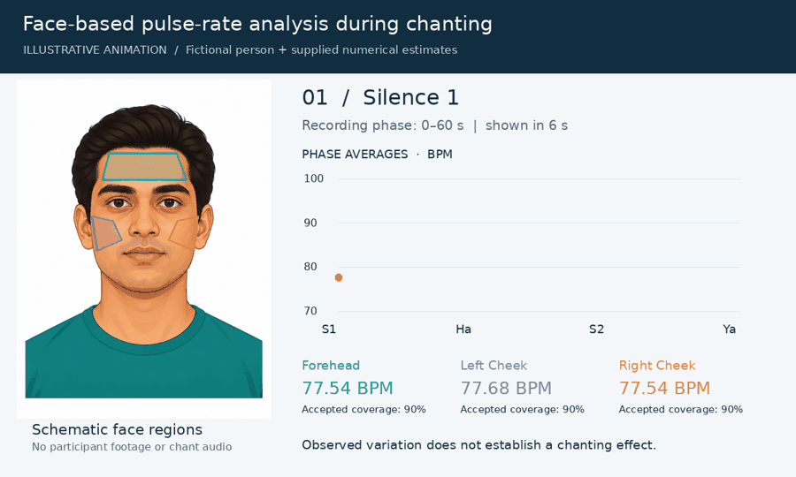
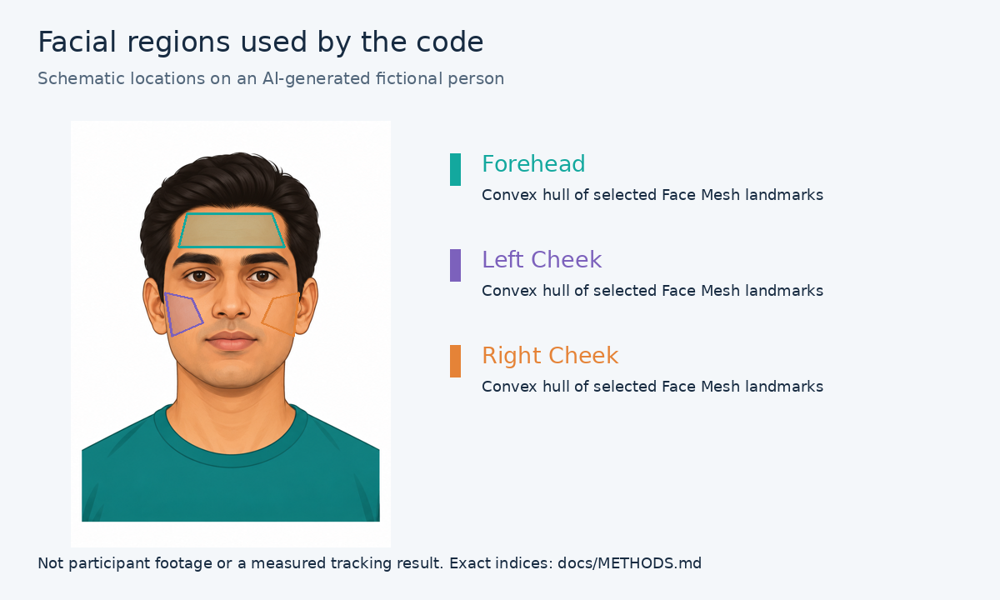
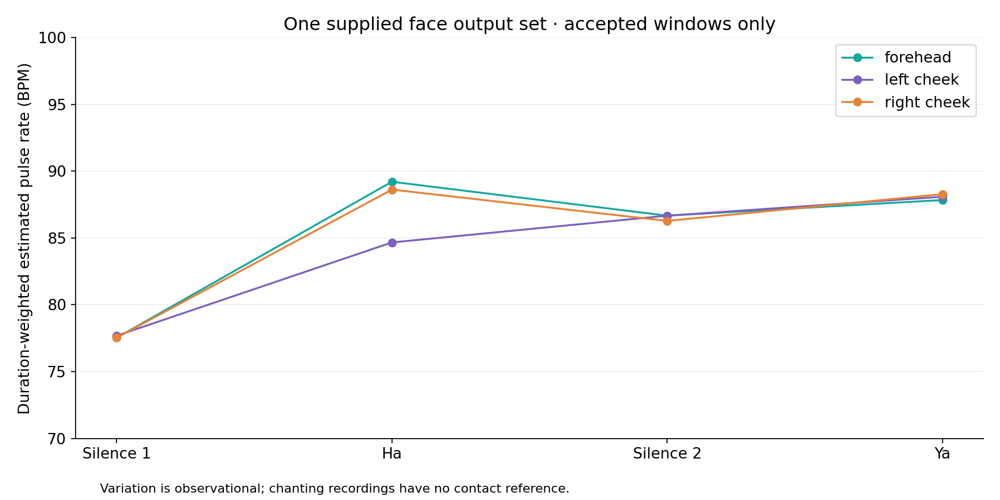

# Face-Based Pulse-Rate Analysis During Chanting

**Facial rPPG · CNN–LSTM · POS comparison · Silence / Ha / Ya**

A Python research prototype for exploring estimated pulse-rate variation across timed silence and chanting phases.

[Methods](docs/METHODS.md) · [Results](docs/RESULTS.md) · [Run locally](docs/GETTING_STARTED.md) · [Publication review](docs/PUBLICATION_REVIEW.md)

## Demonstration

**Illustrative animation:** fictional person, schematic ROI overlays, and phase-average estimates from the supplied face exports. Each 60-second phase is shown in 6 seconds. No participant footage or actual chanting audio is included.

[Download the MP4 demonstration](assets/chanting-demo.mp4)

## What the project does

The pipeline tracks the forehead and both cheeks, predicts a pulse waveform using a custom CNN–LSTM, estimates BPM from its dominant frequency, and compares it with a POS baseline. Quality checks reject unsuitable analysis windows before duration-weighted phase summaries and paired changes are calculated.

The model estimates pulse; the sequence labels are supplied by the user. It does not recognize chants from audio. The public presentation focuses on face outputs. Palm results are excluded because the model's training data are facial recordings and palm performance was unsuitable for this presentation.

## Facial regions

The drawing uses a fictional person. Actual masks are convex hulls of MediaPipe landmarks listed in [Methods](docs/METHODS.md); this drawing is not a tracker output. Left/right follow code labels and may reverse under mirroring.

## Protocol

| Recording time | HA_YA order | YA_HA order |
|---|---|---|
| 0–60 s | Silence | Silence |
| 60–120 s | Ha | Ya |
| 120–180 s | Silence | Silence |
| 180–240 s | Ya | Ha |

Each chant is compared with its immediately preceding silence. The supplied face example uses HA_YA.

## Example results

The supplied forehead estimates average **77.54 → 89.21 → 86.67 → 87.84 BPM** across Silence / Ha / Silence / Ya, using accepted footage only. These are observations from one supplied output set, not proof that chanting caused the changes. [All three face regions, coverage and evaluation scope](docs/RESULTS.md).

## Training and prediction

UBFC-rPPG Dataset 2 is used for supervised facial waveform learning with contact PPG reference. The model is a custom 2D CNN → LSTM → linear waveform head; it is not PhysNet. Incremental training preserves model/optimizer state across subject additions. Validation and test people must remain separate from training.

[Installation, incremental training and exact prediction commands](docs/GETTING_STARTED.md).

No datasets, original faces, trained weights or ROI image caches are included. Reproducing inference requires a locally trained checkpoint. The supplied evaluation tables are retained as exported evidence, not as a new independent evaluation.

## Repository contents

| Location | Contents |
|---|---|
| `src/` | Training, prediction, facial ROI extraction and generic config |
| `tests/` | Supplied engineering checks |
| `results/face_example/` | Face-only numerical exports |
| `results/ubfc_evaluation/` | Supplied small evaluation tables |
| `assets/` | Fictional illustration, charts, GIF and MP4 |
| `docs/` | Methods, results, setup and publication notes |
| `tools/` | Reproducible chart and animation renderer |

## Limits

Motion, lighting, skin visibility, compression and frame timing can affect estimates. POS agreement is a consistency check, not independent ground truth. No contact reference accompanies the chanting example. The supplied UBFC table is small and its train/test separation cannot be independently confirmed without the original registry/checkpoint. This project does not establish medical accuracy, blood-flow volume, or a causal chanting effect. The illustration and mouth animation are never used as model input or evidence.

## Data and method references

- [UBFC-rPPG official dataset page](https://sites.google.com/view/ybenezeth/ubfcrppg). Dataset creators: R. Macwan and Y. Benezeth. Requested citation: S. Bobbia, R. Macwan, Y. Benezeth, A. Mansouri, J. Dubois, “Unsupervised skin tissue segmentation for remote photoplethysmography,” Pattern Recognition Letters, 2017. Obtain data separately and follow its terms.
- [rPPG-Toolbox](https://github.com/ubicomplab/rPPG-Toolbox) supplies the optional official POS comparison. It is not bundled.
- [MediaPipe](https://github.com/google-ai-edge/mediapipe) provides facial landmarks. Python dependencies retain their own licenses.

Illustrated portraits were AI-generated for this repository and depict no supplied participant. Charts and annotations were composed from the supplied numerical exports. No dataset faces were used in the media.

## License

Noncommercial learning and demonstration use of the project-owned material is permitted under [LICENSE.txt](LICENSE.txt). Commercial use requires separate written permission. Dataset and third-party rights are unaffected.
